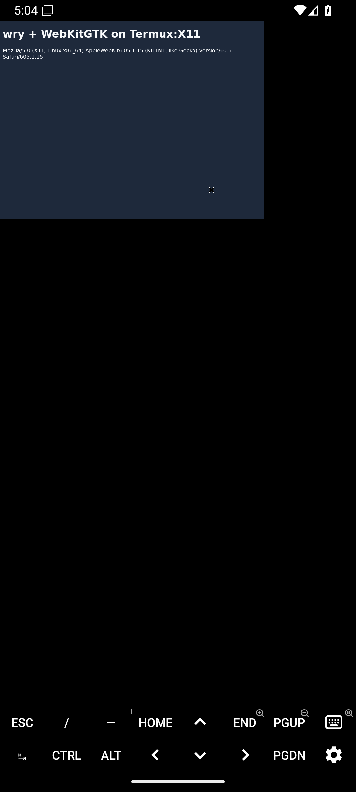

# Rust GUI and audio on Termux:X11 without proot

This document describes how `winit`, `tao`, `wry` and `rodio`/`cpal` applications run
natively on Termux (bionic, no proot-distro) against the Termux:X11 display and a
PulseAudio server. Verified on the Android 16 x86-64 emulator with this fork's
debug build; the same steps target aarch64 devices.

## Why the crates do not work out of the box

Every `*-linux-android` target makes these crates select their *Android app*
backends, which assume an APK with a JVM, an `Activity` and `android.webkit.WebView`:

* `winit` only enables X11/Wayland on `free_unix`, which excludes `target_os = "android"`.
* `tao` picks its ndk/jni backend for `target_os = "android"` and the GTK backend only
  for `target_os = "linux"` and the BSDs.
* `wry` computes `linux = !android && ...` in its build script, so GTK/WebKitGTK
  dependencies never activate for Android targets; its Android backend shells out to
  Kotlin/JNI glue.
* `cpal` compiles only the AAudio host for Android. Opening a stream there calls
  `ndk_context::android_context()`, which panics in a CLI process because no JVM or
  `Activity` context exists. The ALSA, PulseAudio and PipeWire hosts are
  `target_os = "linux"`-only.

None of this is inherent: a Termux process is a plain bionic Linux process that can
talk to an X server over a unix socket and to PulseAudio over its native socket. The
system pieces all exist in the Termux package repos (`termux-x11-nightly`, `gtk3`,
`webkit2gtk-4.1`, `pulseaudio`, `alsa-lib`); only the crates' target detection stands
in the way.

## The patches: `tools/termux-x11/termux-x11-rust`

`termux-x11-rust patch` vendors the crates found in the project's `Cargo.lock`
(from a configurable list: `winit`, `tao`, `wry`, `cpal`) into
`.termux-x11/crates/` and rewrites their target cfgs:

* `target_os = "android"` becomes `target_os = "termux_android_app"` — the APK-only
  backends, JNI deps and `compile_error!`s become dead code.
* `target_os = "linux"` becomes `any(target_os = "linux", target_os = "android")` —
  the X11/GTK/WebKitGTK/ALSA/PulseAudio backends compile for Android targets.
* In `wry`'s build script, `target.contains("android")` becomes `false`, so the
  `linux`/`gtk` cfg aliases activate and the Kotlin generation is skipped.

Cargo picks the vendored copies up through a managed `[patch.crates-io]` block in
`<project>/.cargo/config.toml` (delimited by generated markers; user configuration
is preserved, and `termux-x11-rust clean` removes everything). Existing Linux
targets are unaffected because the rewrites only *widen* the Linux cfgs. The
downside: the patched tree can no longer build real Android APK backends — use
`termux-x11-rust clean` when switching back.

## Display and audio services: `tools/termux-x11/termux-x11-session`

```sh
pkg install x11-repo
pkg install termux-x11-nightly fluxbox pulseaudio alsa-lib gtk3 webkit2gtk-4.1 rust clang pkg-config python
cp tools/termux-x11/termux-x11-session $PREFIX/bin/
termux-x11-session start
eval "$(termux-x11-session env)"
```

`start` launches:

* `termux-x11 :0 -ac` — the X server; clients attach through the abstract socket
  `@/tmp/.X11-unix/X0`, so `DISPLAY=:0` works for every client. The Termux:X11
  *companion app* (APK from the `termux/termux-x11` `nightly` release, opened via
  `am start -n com.termux.x11/.MainActivity` or manually) provides the actual screen.
* a window manager (first of `fluxbox`, `openbox`, `jwm` found; override with
  `TERMUX_X11_WM`, disable with `TERMUX_X11_NO_WM=1`). Without one nothing assigns
  X input focus: pointer events reach windows but keyboard input never does.
  Prefer `fluxbox`: `openbox` pulls in Qt 6 via `obconf-qt` (hundreds of MB).
* `pulseaudio` with `module-aaudio-sink` on Android 8+ (falling back to
  `module-sles-sink`), `module-native-protocol-unix` and `module-always-sink`.
  Clients find it through `$XDG_RUNTIME_DIR/pulse/native` (the session exports
  `XDG_RUNTIME_DIR=$PREFIX/tmp` and `PULSE_SERVER`).

Only one X display can exist at a time: the companion app's service is a singleton, and a second `termux-x11` instance exits with "already has an active X server connection".

## Verified results (2026-11-25, emulator-5554, Android 16 x86-64)

All three example binaries in `tools/termux-x11/examples` built with the on-device
rustc 1.100 (`x86_64-linux-android`) and ran without proot:

| Example | Result |
| --- | --- |
| `winit-window` (winit 0.30.13) | X11 window created and mapped; `xwininfo` shows `winit on Termux:X11` 480x320 under the root window; event loop runs and exits on the deadline. With the session's fluxbox the window gets focus on map and Android key events arrive (`focused: true`, `key: Character("a") Pressed/Released`); taps inside the window deliver `mouse: Left Pressed/Released` |
| `tao-wry` (tao 0.37.3 + wry 0.57.3) | GTK window mapped; WebKitGTK 2.54.3 rendered the page (visually confirmed); JavaScript ran and IPC reported the user agent `Mozilla/5.0 (X11; Linux x86_64) AppleWebKit/605.1.15` |
| `rodio-tone` (rodio 0.23 + cpal 0.18.2) | `cpal host: PulseAudio`, `output device: AAudio Output`, a 2 s 440 Hz tone played through the stream without error |

Input notes: Termux:X11 starts in *Trackpad* touch mode, where a tap clicks at the
current X cursor position rather than at the touched point; use *Simulated
touchscreen* in the Termux:X11 preferences for absolute taps. In *Direct touch*
mode taps move the pointer but produce no winit `MouseInput` (raw touch events
were not checked).

Not verified yet: GPU/EGL acceleration, aarch64 hardware, winit 0.31 (the multi-crate 0.31 series), PipeWire
as a PulseAudio replacement, and the `oboe` backend.

## Audio background

* Android exposes no `/dev/snd/pcm*` to apps, so raw ALSA is compile-time only;
  Termux's `alsa-lib` exists for linking, not hardware access.
* `pulseaudio` in Termux outputs through Android itself: `module-sles-sink` (OpenSL
  ES) or `module-aaudio-sink` (Android 8+). Everything else is a client of its unix
  socket.
* `pipewire` is packaged but built without ALSA/JACK/dbus; it can act as a
  `pipewire-pulse` server but adds nothing over PulseAudio for this use case.
* With the patched cpal, `default_host()` probes `PULSE_SERVER`/the runtime socket
  first and picks PulseAudio when the daemon is up, falling back to ALSA otherwise;
  applications using `rodio` need no changes. The AAudio panic path is compiled out
  entirely.



## Reproducing

```sh
cd tools/termux-x11/examples
python3 ../termux-x11-rust patch
CARGO_BUILD_JOBS=4 cargo build
termux-x11-session start && eval "$(termux-x11-session env)"
./target/debug/winit-window 60   # or tao-wry / rodio-tone
```

Host-side unit tests for the rewriter: `python3 scripts/tests/test_termux_x11_rust.py`.
